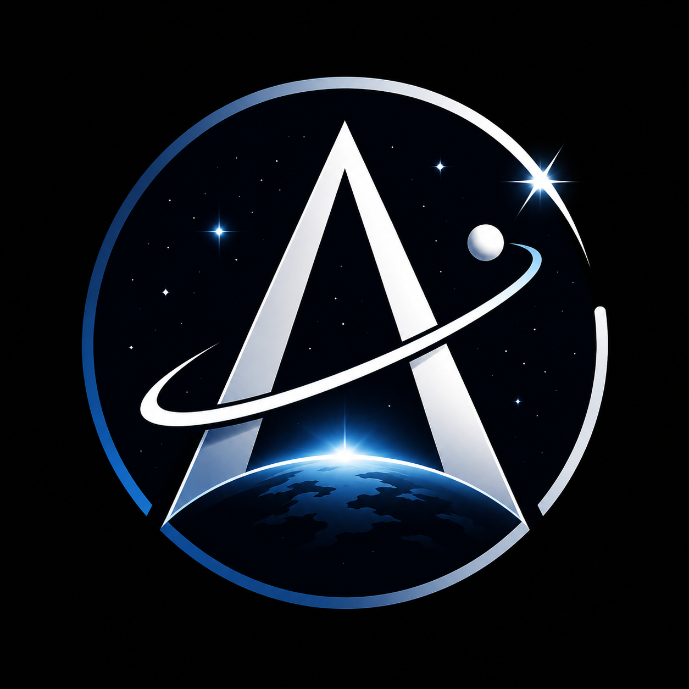

<div align="center">
  

  # SpaceAtlas

  ### Explore the observable universe with NASA's open data

  [](https://kit.svelte.dev/)
  [](https://svelte.dev/)
  [](https://tailwindcss.com/)
  [](https://threlte.xyz/)
  [](https://api.nasa.gov/)
</div>

---

## About

SpaceAtlas is a free, open-source atlas of the observable universe built on NASA's public data. It puts astronomy pictures, Mars rover photos, live Earth imagery, near-Earth asteroid tracking, a real-time ISS tracker, an interactive 3D solar system and an AI space assistant in one dark-themed web app.

SpaceAtlas is an independent fan project and is not affiliated with or endorsed by NASA. All imagery and data belong to their respective owners.

---

## Features

| Page | Description |
|---|---|
| APOD Archive | Browse NASA's Astronomy Picture of the Day with its full history. |
| Mars Rover Photos | Photos from Curiosity, Perseverance and other rovers. |
| Earth from Space | Natural-color EPIC imagery of Earth. |
| Near-Earth Asteroids | Close approaches from NASA's NEO feed. |
| Live ISS Tracker | The International Space Station on a world map, with pass predictions. |
| Interactive 3D Solar System | An explorable solar system built with Three.js and Threlte. |
| Space Gallery | Search NASA's Image and Video Library. |
| Explore and Dashboard | One place to reach every data module. |
| NASA Missions and Timeline | A timeline of major NASA missions. |
| Nova AI Assistant | Ask questions about space, astronomy and how to use SpaceAtlas. |

---

## Tech Stack

- **Framework:** [SvelteKit](https://kit.svelte.dev/) and [Svelte 5](https://svelte.dev/)
- **Styling:** [Tailwind CSS 4](https://tailwindcss.com/)
- **3D:** [Three.js](https://threejs.org/) through [Threlte](https://threlte.xyz/)
- **Maps:** [Leaflet](https://leafletjs.com/)
- **Satellite tracking:** [satellite.js](https://github.com/shashwatak/satellite-js)
- **Icons:** [Lucide Svelte](https://lucide.dev/)
- **Deployment:** [Vercel adapter](https://kit.svelte.dev/docs/adapter-vercel)
- **Package manager:** [Bun](https://bun.sh/) (npm, pnpm and yarn also work)
- **Data:** [NASA Open APIs](https://api.nasa.gov/)

---

## Getting Started

You need [Node.js](https://nodejs.org/) or [Bun](https://bun.sh/) and a free NASA API key.

```bash
git clone https://github.com/Itz-Anya/Space-Atlas.git
cd Space-Atlas
bun install
```

Create a `.env` file in the project root:

```env
NASA_API_KEY=your_nasa_api_key_here
```

You can get a key at [api.nasa.gov](https://api.nasa.gov/). Without one the app uses NASA's rate-limited `DEMO_KEY`.

```bash
bun run dev
bun run build
```

`npm run dev` and `npm run build` work the same way.

---

## Data Sources

APOD, Mars Rover Photos, EPIC, NeoWs and the NASA Image and Video Library, all from [NASA's Open APIs](https://api.nasa.gov/).

---

## Creators

- **Murali** ([@Itz-Murali](https://github.com/Itz-Murali)), Senior Developer
- **Anya** ([@Itz-Anya](https://github.com/Itz-Anya)), Junior Developer

---

<p align="center">If you like this project, give the repo a star.</p>
